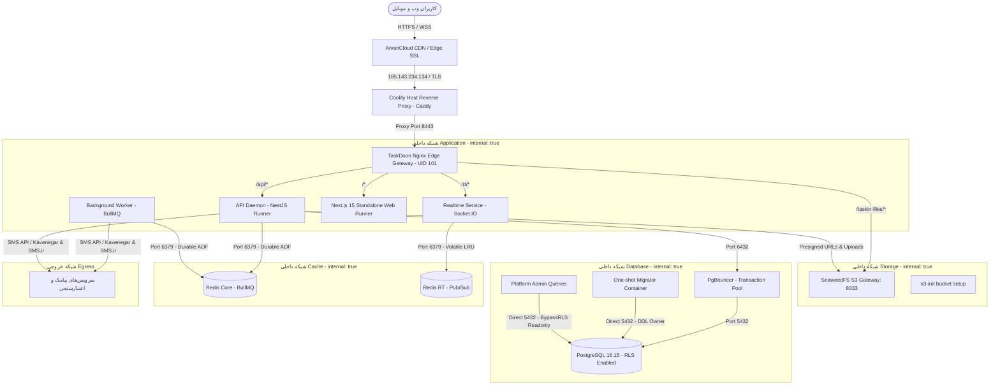
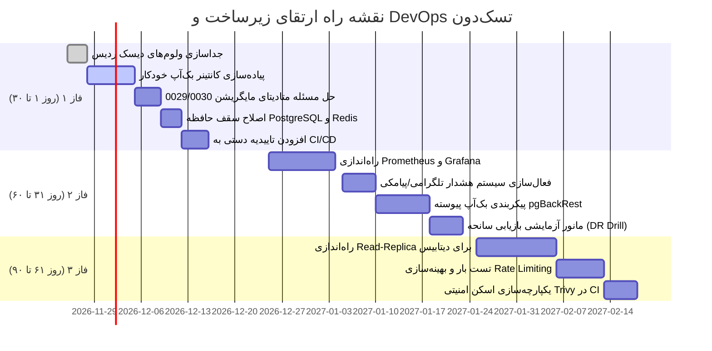

# گزارش جامع ممیزی زیرساخت، پایداری و امنیت پلتفرم تسک‌دون (TaskDoon)

**نقش:** Senior DevOps Engineer, SRE, Infrastructure Security Lead & Release Manager  
**محصول:** پلتفرم سازمانی مدیریت وظایف تسک‌دون (TaskDoon)  
**دامنه بررسی:** مخزن گیت‌هاب `garusianx-spec/TaskDoon`، محیط پروداکشن زنده `https://taskdoone.ir`، فایل‌های کانتینرسازی و اسکریپت‌های CI/CD  
**تاریخ گزارش:** ۲۴ نوامبر ۲۰۲۶ (۴ آذر ۱۴۰۵)  
**وضعیت ارزیابی نهایی (Release Verdict):** **CONDITIONAL (مشروط)**

---

## ۱. ارزیابی جامع معماری زیرساخت (Infrastructure Architecture Assessment)

زیرساخت TaskDoon به عنوان یک پلتفرم B2B چندمستاجره (Multi-tenant) با رویکرد امنیت حداکثری و ایزولاسیون طراحی شده است:



### نقاط قوت معماری بررسی‌شده از سورس کد:
1. **ایزولاسیون پردازه‌ها و کانتینرها (Container Hardening):** تمام کانتینرها در `docker-compose.prod.yml` با `read_only: true`، حذف دسترسی‌های کرنل (`cap_drop: [ALL]`)، `no-new-privileges: true` و اجرای تحت کاربر غیر روت (`node` با UID 1000 یا `postgres` با UID 70) پیکربندی شده‌اند.
2. **ساخت ایمیج‌های مینیمال بر پایه Scratch:** با استفاده از ابزار `binutils` و کامپایل بهینه، تمام پکیج منیجرها (`npm`, `apk`, `yarn`) و کامپایلرها از ایمیج نهایی حذف شده و حجم ایمیج‌های پروداکشن به شدت کاهش یافته است (API ~ 234MB, Web ~ 175MB, Migrator ~ 124MB).
3. **تفکیک سطوح دسترسی دیتابیس (Principle of Least Privilege):**
   - کاربر `taskin_app`: دسترسی صرفاً DML، بدون امکان دور زدن RLS.
   - کاربر `taskin_migrator`: مالک جداول و تنها مجری DDL migrations.
   - کاربر `taskin_platform_admin`: دارای `BYPASSRLS` اما مقید به `default_transaction_read_only = on`.
4. **تزریق تنظیمات مستاجر در تراکنش‌های محلی:** استفاده از `set_config('app.workspace_id', ..., true)` داخل `UnitOfWork.run` باعث جلوگیری از نشت اطلاعات بین مستاجران (Tenant Bleed) در ارتباط با PgBouncer می‌شود.

---

## ۲. ده ریسک و شکاف عملیاتی تاییدشده (Top 10 Verified Risks & Operational Gaps)

> [!CAUTION]
> موارد زیر مستقیماً از سورس کد و پیکربندی‌های فعلی استخراج شده‌اند و سلامت و پایداری داده‌های کسب‌وکار را تحت تأثیر قرار می‌دهند.

---

### ریسک ۱ (P0): فقدان کامل سیستم پشتیبان‌گیری خودکار (Automated Backups) و سناریوی بازیابی
- **شدت:** P0 (بسیار بحرانی)
- **شواهد (Evidence):** در فایل `docker-compose.prod.yml` و دایرکتوری `infra/prod/` هیچ کانتینر بک‌آپ، اسکریپت `pg_dump`، مکانیزم WAL Archiving و هیچ Cron Job فعالی وجود ندارد. در مستند `docs/rfc/0001-backend-architecture.md:255` به ابزار `pgBackRest` اشاره شده، اما در کد اجرایی پیاده‌سازی نشده است.
- **اثر (Impact):** در صورت خرابی دیسک سرور، کرش ولوم Docker یا خطای انسانی، ۱۰۰٪ اطلاعات کسب‌وکار و کاربران غیرقابل بازگشت خواهد بود.
- **علت ریشه‌ای (Root Cause):** فاز کانتینرسازی بدون نهایی‌سازی سرویس جانبی (Sidecar) بک‌آپ و ارسال به فضای ذخیره‌سازی ابری ثانویه متوقف شده است.
- **راهکار پیشنهادی (Recommended Fix):** پیاده‌سازی کانتینر مستقل پشتیبان‌گیری در Compose با اجرای روزانه `pg_dump` رمزنگاری‌شده و همگام‌سازی لحظه‌ای با فضای S3 ابری دوم (Arvan S3 یا سرور بک‌آپ مجزا).
- **ریسک تغییر:** سربار موقت IO روی دیسک هنگام تهیه نسخه پشتیبان.
- **برنامه بازگشت (Rollback Plan):** توقف کانتینر بک‌آپ در صورت افزایش لود سرور و تغییر ساعت اجرا به زمان کم‌ترافیک (۰۳:۳۰ بامداد).
- **مراحل راستی‌آزمایی (Verification):** اجرای دستی اسکریپت، بررسی خروجی دامپ، تست بازیابی در یک دیتابیس تستی و اعتبارسنجی یکپارچگی داده‌ها.

---

### ریسک ۲ (P0): ریسک ناسازگاری هیستوری مایگریشن‌های دیتابیس (Migration 0029 vs 0030 Ghost History)
- **شدت:** P0 (بسیار بحرانی)
- **شواهد (Evidence):** در تاریخچه کامیت‌ها، کامیت `7987c37` فایل `0030_bouncy_texas_twister.sql` را اضافه کرد که دقیقاً فیلدهای تکراری `sms_attempts` و `sms_link_sealed` از مایگریشن `0029_invitation_sms_attempts.sql` را داشت. سپس در کامیت `8fee802` این فایل پاک شد و `_journal.json` بازنویسی گردید.
- **اثر (Impact):** اگر کامیت `7987c37` روی پروداکشن اعمال شده باشد، جدول `__drizzle_migrations` در دیتابیس پروداکشن رکورد `0030` را ذخیره کرده است. در استقرارهای جدید که ژورنال به `0029` ختم می‌شود، Migrator ممکن است به خطای ناسازگاری بخورد یا کانتینر Migrator کرش کند و کل دیپلوی مسدود شود.
- **علت ریشه‌ای (Root Cause):** عدم هماهنگی برنچ‌ها و تولید مجدد مایگریشن به جای فیکس کردن آن در سطح پایگاه داده و سپس حذف فیزیکی فایل مایگریشن از گیت.
- **راهکار پیشنهادی (Recommended Fix):** اجرای کوئری فقط‌خواندنی زیر روی دیتابیس پروداکشن برای بررسی وضعیت:
  ```sql
  SELECT id, hash, created_at FROM __drizzle_migrations ORDER BY id DESC LIMIT 5;
  ```
  در صورت وجود رکورد `0030`، دیتابیس با ژورنال هماهنگ شود و یک Guard در `apps/api/src/platform/db/migrate.ts` قرار گیرد.
- **ریسک تغییر:** اصلاح دستی متادیتای مایگریشن.
- **برنامه بازگشت (Rollback Plan):** پشتیبان‌گیری کامل از جدول `__drizzle_migrations` پیش از هرگونه تغییر.
- **مراحل راستی‌آزمایی:** تست `drizzle-kit check` و اجرای آزمایشی روی دامپ پروداکشن در محیط تستی ایزوله.

---

### ریسک ۳ (P1): استقرار مستقیم و خودکار روی پروداکشن با هر Merge به شاخه Main
- **شدت:** P1 (بحرانی)
- **شواهد (Evidence):** ورک‌فلو `.github/workflows/release.yml` با `on: push: branches: [main]` بلافاصله پس از مرج، مراحل تست، ساخت ایمیج، پروموت تگ‌ها و شلیک وبهوک Coolify را اجرا می‌کند.
- **اثر (Impact):** هیچ محیط Staging وجود ندارد و هر کامیت ناقص یا باگ منطقی فوراً در دسترس کاربران نهایی قرار می‌گیرد.
- **علت ریشه‌ای (Root Cause):** پیکربندی پایپ‌لاین CD پیوسته بدون گیت تاییدیه انسانی (Human-in-the-loop) و بدون ارزیابی در محیط پیش‌تولید.
- **راهکار پیشنهادی (Recommended Fix):** فعال‌سازی قابلیت GitHub Environment Protection با تایید اجباری Release Manager، یا هدایت اتوماتیک به محیط Staging و استقرار در پروداکشن فقط از طریق Release Tag یا تایید دستی در GitHub Actions.
- **ریسک تغییر:** تاخیر کنترل‌شده در انتشار کد.
- **برنامه بازگشت:** حذف شرط Approval در صورت اضطرار استقرار Hotfix.
- **مراحل راستی‌آزمایی:** ایجاد یک PR تستی روی مخزن و مشاهده متوقف شدن فرآیند قبل از مرحله Promote و Deploy.

---

### ریسک ۴ (P1): عدم وجود مکانیزم بازگشت به عقب خودکار (No Automated Rollback) و تگ‌های شناور
- **شدت:** P1 (بحرانی)
- **شواهد (Evidence):** ایمیج‌ها با تگ شناور `:latest` بازنویسی می‌شوند. اسکریپت `infra/ci/trigger-coolify.mjs` وضعیت خروجی کانتینرها را در Coolify بررسی نمی‌کند و پس از ارسال وبهوک پایان می‌یابد. همچنین هیچ مایگریشن معکوسی (`down.sql`) وجود ندارد.
- **اثر (Impact):** در صورت بروز خطای مهلک در نسخه جدید، بازگشت به نسخه قبل نیازمند Revert در گیت و حداقل ۱۵ الی ۲۵ دقیقه انتظار برای بیلد مجدد ایمیج‌هاست.
- **علت ریشه‌ای (Root Cause):** عدم استفاده از Commit SHA اختصاصی در اجرای کانتینرها در Coolify و نبود اسکریپت رول‌بک.
- **راهکار پیشنهادی (Recommended Fix):** استقرار در Coolify بر مبنای تگ اختصاصی `sha-${GITHUB_SHA}`؛ اضافه کردن مرحله Post-Deployment Verification در CI که سلامت `/health/ready` را چک کرده و در صورت خطا، فوراً تگ قبلی را صدا بزند.
- **ریسک تغییر:** افزایش تعداد تگ‌های ذخیره‌شده در GHCR.
- **برنامه بازگشت:** جابجایی دستی تگ در داشبورد Coolify به SHA پایدار قبلی.
- **مراحل راستی‌آزمایی:** شبیه‌سازی دیپلوی ناموفق در محیط تست و ارزیابی فراخوانی خودکار نسخه پایدار قبلی.

---

### ریسک ۵ (P1): اشتراک ولوم نام‌گذاری‌شده بین redis-core و redis-rt (Volume Data Collision)
- **شدت:** P1 (بحرانی)
- **شواهد (Evidence):** در فایل `docker-compose.prod.yml`، هر دو سرویس `redis-core` و `redis-rt` خط زیر را دارند:
  ```yaml
  volumes: [redisdata:/data]
  ```
- **اثر (Impact):** سرویس `redis-core` دارای ماندگاری AOF (`appendonly yes`) است، در حالی که `redis-rt` فرار و بدون ماندگاری است (`appendonly no`). اشتراک دایرکتوری `/data` ریسک آسیب به فایل‌های AOF یا تداخل در قفل فایل‌ها و ریستارت کانتینرها را در پی دارد.
- **علت ریشه‌ای (Root Cause):** خطای کپی‌پست در تعریف Volumeهای کانتینرها.
- **راهکار پیشنهادی (Recommended Fix):** تفکیک ولوم‌ها به `redis-core-data:/data` و حذف ولوم یا اختصاص ولوم جداگانه به `redis-rt`.
- **ریسک تغییر:** نیاز به بازنشانی ولوم ردیس هنگام تغییر پیکربندی.
- **برنامه بازگشت:** برگرداندن نام ولوم در صورت عدم استارت.
- **مراحل راستی‌آزمایی:** اجرای `docker inspect` و اطمینان از مجزا بودن مسیرهای دیسک کانتینرها.

---

### ریسک ۶ (P1): محدودیت حافظه ناکافی و خطر فعال شدن OOM Killer برای دیتابیس
- **شدت:** P1 (بحرانی)
- **شواهد (Evidence):** در `docker-compose.prod.yml`:
  - کانتینر `postgres` دارای `mem_limit: 512m` با `max_connections=100` و `shared_buffers=128MB` است.
  - کانتینر `redis-core` دارای `mem_limit: 256m` با `maxmemory 256mb` است.
- **اثر (Impact):** در ساعات اوج مصرف و تراکنش‌های همزمان، حافظه اختصاص‌یافته برای اتصالات فراتر از ۵۱۲ مگابایت رفته و کرنل لینوکس از طریق cgroup اقدام به Kill کردن پراسس PostgreSQL می‌کند که قطعی ناگهانی سامانه را به همراه دارد. در ردیس نیز پیش از اعمال سیاست Eviction، داکر کانتینر را از بین می‌برد.
- **علت ریشه‌ای (Root Cause):** استفاده از مقادیر تستی محلی به جای مقادیر متناسب با پروداکشن سازمانی.
- **راهکار پیشنهادی (Recommended Fix):** افزایش سقف حافظه PostgreSQL به حداقل 2GB و ردیس به 512MB (با حفظ `maxmemory 256mb` در ردیس جهت ایجاد بافر برای پردازش داخلی).
- **ریسک تغییر:** نیاز به وجود رم کافی روی هاست Coolify.
- **برنامه بازگشت:** تنظیم تدریجی محدودیت‌ها متناسب با منابع سرور.
- **مراحل راستی‌آزمایی:** اعمال لود تست با ۵۰ اتصال همزمان و بررسی میزان مصرف RSS رم کانتینرها.

---

### ریسک ۷ (P1): فقدان نسخه پشتیبان، لاگ و رپلیکیشن برای فایل‌های SeaweedFS
- **شدت:** P1 (بحرانی)
- **شواهد (Evidence):** کانتینر `s3` داده‌ها را در ولوم محلی `s3data:/data` ذخیره می‌کند. هیچ رپلیکیشن یا ارسال آبجکت‌ها به استوریج پشتیبان (Object Replication) تعریف نشده است.
- **اثر (Impact):** هرگونه آسیب به دیسک یا ولوم، باعث نابودی غیرقابل جبران تمام اسناد، تصاویر، رزومه‌ها و فایل‌های ضمیمه کاربران در تسک‌دون می‌شود.
- **علت ریشه‌ای (Root Cause):** عدم راه‌اندازی ابزار همگام‌سازی ابری نظیر Rclone یا MinIO/Seaweed Mirroring.
- **راهکار پیشنهادی (Recommended Fix):** فعال‌سازی جاب دوره‌ای Rclone جهت همگام‌سازی افزایشی (Incremental) باکت `taskin-files` با یک استوریج ابری ثالث خارج از سرور.
- **ریسک تغییر:** مصرف ترافیک شبکه حین آپلود بک‌آپ‌ها.
- **برنامه بازگشت:** متوقف کردن اسکریپت در صورت تداخل در پهنای باند.
- **مراحل راستی‌آزمایی:** آپلود یک فایل در تسک‌دون، اجرای جاب Rclone و اعتبارسنجی حضور فایل در باکت مقصد.

---

### ریسک ۸ (P2): عدم راه‌اندازی استک مانیتورینگ متمرکز (Prometheus / Grafana / APM) و لاگ‌های غیرمتمرکز
- **شدت:** P2 (متوسط تا بالا)
- **شواهد (Evidence):** در `apps/api/src/instrument.ts` قابلیت OpenTelemetry پیاده شده ولی متغیر `OTEL_EXPORTER_OTLP_ENDPOINT` روی پروداکشن ست نشده است. لاگ‌ها به صورت محلی در فایل‌های داکر محدود به ۶۰ مگابایت ذخیره و حذف می‌شوند.
- **اثر (Impact):** نبود امکان کشف و ریشه‌یابی خطاهای ۵۰۰، کندی کوئری‌ها، وضعیت صف‌های BullMQ و گلوگاه‌های سیستمی قبل از اعلام نارضایتی توسط مشتریان.
- **علت ریشه‌ای (Root Cause):** عدم استقرار کانتینرهای مانیتورینگ در فاز راه‌اندازی اولیه.
- **راهکار پیشنهادی (Recommended Fix):** استقرار پکیج ویکتور/الوی (Grafana Alloy) یا Prometheus + Node Exporter به همراه ابزار جمع‌آوری لاگ Loki و داشبورد Grafana.
- **ریسک تغییر:** اختصاص حدود ۲۰۰ مگابایت رم برای مانیتورینگ.
- **برنامه بازگشت:** غیرفعال‌سازی سرویس در صورت کمبود شدید منابع.
- **مراحل راستی‌آزمایی:** ایجاد یک خطای تست و مشاهده ردگیری (Trace) آن در داشبورد تله‌متری.

---

### ریسک ۹ (P2): خطرات تراکنش و Prepared Statements در PgBouncer Transaction Pooling
- **شدت:** P2 (متوسط)
- **شواهد (Evidence):** تنظیم `POOL_MODE: transaction` در PgBouncer. در Drizzle ORM اتصالات از نوع Connection Pool استفاده می‌کنند. هرچند `UnitOfWork` به شکل تراکنشی نوشته شده، اما در صورت استفاده از Prepared Statement‌های دارای نام در خارج از متد Unit، خطای سرور رخ خواهد داد.
- **اثر (Impact):** شکست کوئری‌ها در اتصالات اشتراکی یا نشت تنظیمات سشن در صورت عدم رعایت دقیق پروتکل ایزولاسیون.
- **علت ریشه‌ای (Root Cause):** ماهیت Transaction Pooling که در پایان هر تراکنش کانکشن را به کلاینت دیگری تحویل می‌دهد.
- **راهکار پیشنهادی (Recommended Fix):** اطمینان از غیرفعال بودن Named Prepared Statements در درایور `pg` برای پورت ۶۴۳۲ و اضافه کردن تست‌های اتوماسیون برای جلوگیری از اجرای مستقیم کوئری خارج از UnitOfWork.
- **ریسک تغییر:** صفر (مطابق استانداردهای جهانی PgBouncer).
- **برنامه بازگشت:** نیازی نیست.
- **مراحل راستی‌آزمایی:** اجرای تست بار چندمستاجره همزمان و پایش لاگ‌های PgBouncer برای خطاهای `prepared statement already exists`.

---

### ریسک ۱۰ (P2): مغایرت پیکربندی TLS و مسیریابی لبه بین تست محلی و پروداکشن
- **شدت:** P2 (متوسط)
- **شواهد (Evidence):** در پروداکشن زنده، لبه توسط ابر آروان (`185.143.234.134`) و سپس Caddy مدیریت می‌شود، اما در مخزن صرفاً `infra/prod/nginx.conf` نگهداری می‌شود. همچنین مسیر `/health/ready` در Nginx لبه به کانتینر API فوروارد نمی‌شود، بلکه به Web متصل است.
- **اثر (Impact):** ناهمخوانی هدرهای امنیتی، عدم امکان مانیتورینگ خارجی سلامت عمیق API و تفاوت در مدیریت وب‌سوکت‌ها بین محیط لوکال و پروداکشن.
- **علت ریشه‌ای (Root Cause):** عدم مستندسازی معماری دو لایه‌ای (ArvanCloud + Caddy + Nginx).
- **راهکار پیشنهادی (Recommended Fix):** همگام‌سازی مسیرهای هدایت هدرها، تنظیم مسیر اختصاصی `/api/health/ready` و مستندسازی دقیق تنظیمات لایه Caddy در ریپازیتوری.
- **ریسک تغییر:** تغییر جزیی در روت‌های Nginx.
- **برنامه بازگشت:** بازگرداندن فایل `nginx.conf`.
- **مراحل راستی‌آزمایی:** اعتبارسنجی هدر `X-Forwarded-For` در وب‌سوکت‌های لایو `/rt/`.

---

## ۳. طرح جامع بازیابی پس از سانحه و پشتیبان‌گیری (Backup & Disaster Recovery Plan)

### اهداف عملیاتی (SLA/SLO):
- **RPO (حداکثر زمان از دست رفتن داده):** ۱۵ دقیقه برای تراکنش‌های دیتابیس؛ ۱ ساعت برای فایل‌های ذخیره‌شده.
- **RTO (حداکثر زمان بازگشت سامانه به مدار):** ۳۰ دقیقه برای کل سرویس‌ها.

### ساختار پشتیبان‌گیری چندسطحی (3-2-1 Strategy):
1. **سطح ۱ (دیتابیس PostgreSQL):**
   - پشتیبان‌گیری کامل (Full Backup) با فرمت فشرده `pg_dump -Fc` هر شب در ساعت ۰۳:۰۰ بامداد.
   - نگهداری آرشیو WAL (در فاز دوم با pgBackRest) جهت بازگردانی نقطه در زمان (Point-In-Time Recovery - PITR).
   - سیاست نگهداری (Retention): ۷ نسخه روزانه، ۴ نسخه هفتگی، ۱۲ نسخه ماهانه.
2. **سطح ۲ (فایل‌ها و پیوست‌های SeaweedFS):**
   - اسکریپت همگام‌سازی روزانه به باکت امن خارج از سرور با `rclone sync --fast-list`.
3. **سطح ۳ (کش و صف‌های Redis Core):**
   - پشتیبان‌گیری روزانه از دایرکتوری AOF پیش از پاکسازی‌های دوره‌ای.

### دستورالعمل گام‌به‌گام بازیابی بحران (Disaster Recovery Runbook):
```sh
# ۱. توقف کانتینرهای سرویس‌دهنده جهت جلوگیری از نوشتن داده جدید
docker compose -f docker-compose.prod.yml stop api web realtime worker

# ۲. بازگردانی پایگاه داده از آخرین نسخه معتبر
docker exec -i taskdoon-prod-postgres-1 dropdb -U postgres taskin
docker exec -i taskdoon-prod-postgres-1 createdb -U postgres -O taskin_migrator taskin
gunzip -c /backups/taskin_db_latest.dump.gz | docker exec -i taskdoon-prod-postgres-1 pg_restore -U postgres -d taskin --clean --if-exists

# ۳. اجرای ایمن مایگریشن‌های معلق احتمالی
docker compose -f docker-compose.prod.yml run --rm migrate

# ۴. بازنشانی ولوم آبجکت استوریج در صورت آسیب
rclone sync offsite-backup:taskdoon-files-backup /var/lib/docker/volumes/taskdoon-prod_s3data/_data

# ۵. استارت مجدد کل استک و اعتبارسنجی وضعیت
docker compose -f docker-compose.prod.yml up -d
curl -f https://localhost:8443/health/ready
```

---

## ۴. طرح پیشنهادی سیستم پایش و هشداردهی (Monitoring & Alerting)

### سنجه‌ها (Metrics) و نقاط پایش:
| حوزه پایش | ابزار جمع‌آوری | سنجه‌های کلیدی | آستانه بحرانی (Alert Threshold) |
| :--- | :--- | :--- | :--- |
| **سرور و هاست** | Node Exporter | CPU, Memory, Disk IO, Disk Space | مصرف دیسک > ۸۵٪ ، رم > ۹۰٪ |
| **کانتینرها** | cAdvisor | Container Restarts, OOM Events, CPU Throttling | ریستارت کانتینر در ۵ دقیقه گذشته |
| **پایگاه داده** | Postgres Exporter | Active Connections, Deadlocks, Slow Queries, Pool Saturation | اتصالات > ۸۰٪، قفل بیش از ۱۰ ثانیه |
| **ردیس** | Redis Exporter | Used Memory, Connected Clients, Evicted Keys | حافظه > ۸۰٪ سقف، خطا در اتصال صف |
| **اپلیکیشن** | OpenTelemetry | HTTP 5xx Error Rate, p95/p99 Response Latency | خطای ۵xx بیش از ۲٪ در ۳ دقیقه |

### ماتریس هشداردهی اضطراری:
- **سطح P0 (فوری - پیامک و تماس خودکار):** قطعی دیتابیس، عدم پاسخگویی لبه، خطای کلی در استقرار.
- **سطح P1 (مهم - ربات تلگرام و اسلک تیم دواپس):** کندی شدید پاسخ‌ها (p95 > 2s)، اشباع شدن استخر کانکشن‌های PgBouncer.
- **سطح P2 (هشدار پیشگیرانه - ایمیل گزارش روزانه):** نزدیک شدن انقضای گواهی TLS به کمتر از ۱۴ روز، افزایش حجم دیسک لاگ‌ها.

---

## ۵. پیشنهادات ارتقای پایپ‌لاین CI/CD و ایمنی انتشارات

1. **پیاده‌سازی گیت تاییدیه تولید (Production Approval Gate):**
   - در تنظیمات مخزن گیت‌هاب، محیط `production` باید ملزم به تایید یکی از اعضای ارشد فنی یا Release Manager باشد.
2. **استقرار مبتنی بر Commit SHA به جای تگ شناور Latest:**
   - تغییر فراخوانی Coolify جهت کشیدن و اجرای ایمیج با تگ یکتای `sha-${GITHUB_SHA}` تا دقیقاً همان نسخه تست‌شده در CI بالا بیاید.
3. **مرحله راستی‌آزمایی پس از استقرار (Smoke Tests in Pipeline):**
   - اضافه کردن Step به انتهای ورک‌فلو که پس از ارسال وبهوک به Coolify، به مدت ۶۰ ثانیه اندپوینت سلامت لایو را پولینگ کند؛ در صورت عدم پاسخگویی، هشدار شکست ارسال شود.

---

## ۶. نقشه راه اولویت‌بندی شده DevOps (برنامه ۳۰ / ۶۰ / ۹۰ روزه)



---

## ۷. تسک‌های فنی آماده برای اسپرینت تیم توسعه و زیرساخت (Sprint-Ready Tasks)

### تسک ۱: جداسازی ولوم‌های دیسک سرویس‌های Redis
- **هدف:** جلوگیری از اشتراک داده بین `redis-core` و `redis-rt`.
- **فایل هدف:** `docker-compose.prod.yml`
- **معیارهای پذیرش (Acceptance Criteria):**
  - سرویس `redis-core` از ولوم مجزای `redis-core-data:/data` استفاده کند.
  - سرویس `redis-rt` فاقد ولوم مشترک باشد یا از ولوم مجزای فرار استفاده کند.
  - کانتینرها بدون خطا بالا آمده و فایل‌های AOF صرفاً در ولوم Core تولید شوند.

### تسک ۲: راه‌اندازی سرویس بک‌آپ‌گیری خودکار روزانه دیتابیس و S3
- **هدف:** پوشش ریسک بحرانی P0 عدم وجود پشتیبان خودکار.
- **فایل هدف:** `infra/prod/backup/` و افزودن سرویس به Compose.
- **معیارهای پذیرش:**
  - اسکریپت روزانه در ساعت ۰۳:۳۰ بامداد فایل فشرده دامپ را تولید و با فرمت رمزنگاری‌شده در پوشه خروجی قرار دهد.
  - فایل به باکت پشتیبان خارج از سرور منتقل شود.
  - گزارش موفقیت یا خطا لاگ شود.

### تسک ۳: ایجاد مکانیزم ایمنی اعتبارسنجی مایگریشن پیش از اجرا
- **هدف:** جلوگیری از توقف پروداکشن در صورت مغایرت ژورنال مایگریشن‌ها.
- **فایل هدف:** `apps/api/src/platform/db/migrate.ts`
- **معیارهای پذیرش:**
  - پیش از اجرای `migrate()`، جدول `__drizzle_migrations` خوانده شده و وجود رکوردهای یتیم (مانند `0030` حذف‌شده) بررسی شود.
  - در صورت وجود ناهماهنگی، لاگ هشداری شفاف با راهنمای رفع صادر گردد و عملیات متوقف نشود یا خطای کنترل‌شده بدهد.

### تسک ۴: ایجاد گیت تاییدیه دستی در GitHub Actions Release
- **هدف:** توقف استقرار مستقیم و ناخواسته روی پروداکشن.
- **فایل هدف:** `.github/workflows/release.yml`
- **معیارهای پذیرش:**
  - جاب‌های `promote` و `deploy` تحت Environment با عنوان `production` قرار گیرند.
  - تا زمان تایید یکی از Reviewerها، هیچ تگی در GHCR به عنوان Latest بازنویسی نشود و وبهوک Coolify شلیک نگردد.

---

## ۸. رای نهایی آمادگی تولید (Production Readiness Verdict)

### **نتیجه: CONDITIONAL (مشروط)**

**دلایل و شروط ارزیابی:**
معماری پایه نرم‌افزار، امنیت رول‌ها در دیتابیس (RLS)، ساخت کانتینرهای ایمن و جداسازی شبکه‌ها با کیفیت بسیار بالایی پیاده‌سازی شده است. با این حال، با توجه به قوانین صریح مهندسی قابلیت اطمینان سایت (SRE) و مدیریت انتشار، موارد زیر استقرار بدون قید و شرط را ناممکن می‌سازد:
1. **فقدان هرگونه پشتیبان‌گیری خودکار فعال از دیتابیس و فایل‌های کاربران (P0).**
2. **ابهام در هیستوری مایگریشن‌های اعمال‌شده روی دیتابیس لایو (تداخل 0029 و 0030) (P0).**
3. **استقرار کاملاً مستقیم به پروداکشن بدون وجود گیت تاییدیه انسانی یا پایپ‌لاین بازگشت به عقب (P1).**

**اقدام لازم جهت تبدیل به وضعیت GO:**
اجرای فوری تسک‌های فاز ۱ (به ویژه راه‌اندازی بک‌آپ، بررسی متادیتای مایگریشن پروداکشن و تفکیک ولوم‌های ردیس).
